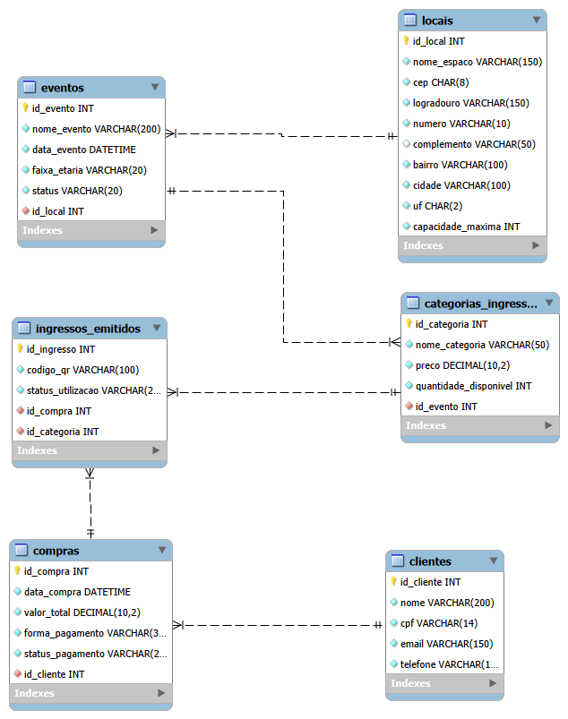
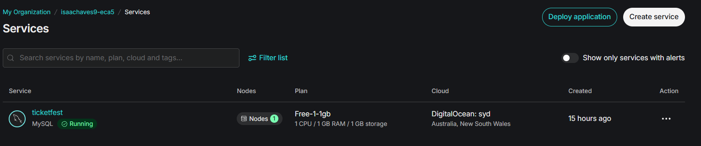
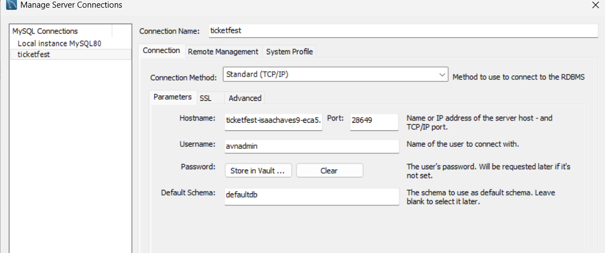
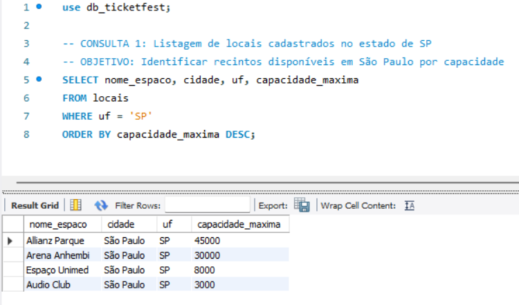
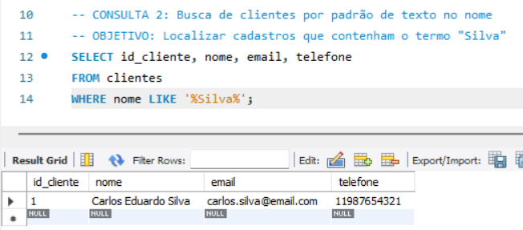
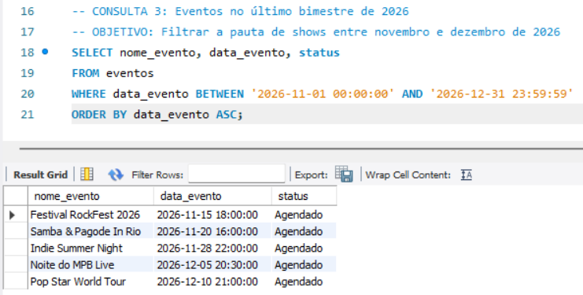

# TicketFest - Sistema de Gestao e Venda de Ingressos

Projeto de Banco de Dados Relacional desenvolvido para a disciplina de SGBD (SEDUC DEST2). A TicketFest e uma plataforma especializada na comercializacao de ingressos e controle de acesso para shows e festivais de grande porte.

---

## Modelo de Banco de Dados (Diagrama EER)

---

## Problema vs. Solucao com SGBD

| Problema (Sem SGBD) | Solucao Implementada (Com SGBD Relacional) |
| :--- | :--- |
| Overbooking em picos de venda | Controle de concorrencia com Transacoes ACID e locking de registros. |
| Prejuizos na virada de lote manual | Automacao com restricoes e regras de integridade na tabela categorias_ingressos. |
| Fraudes e QR Codes clonados | Restricao de unicidade (UNIQUE) para o codigo_qr e atualizacao atomica de status. |
| Vulnerabilidade a LGPD | Centralizacao dos dados de clientes e controle de acesso por perfis (RBAC). |

---

## Hospedagem em Nuvem (DBaaS) - Aiven

Para garantir alta disponibilidade e acesso remoto, o banco de dados da TicketFest foi hospedado na plataforma Aiven. A arquitetura exige conexoes com certificado SSL ativo, criptografando o trafego de dados e assegurando a conformidade com a LGPD.

**Evidencias da Hospedagem:**

---

## Estrutura das Tabelas

1. **locais**: Cadastro de arenas e espacos (endereco atomizado e capacidade maxima).
2. **eventos**: Festivais e shows vinculados a um local.
3. **categorias_ingressos**: Setores, lotes e precos vinculados a cada evento.
4. **clientes**: Dados cadastrais dos compradores (CPF e e-mail unicos).
5. **compras**: Registros de pedidos e formas de pagamento.
6. **ingressos_emitidos**: Bilhetes individuais gerados com hash de QR Code.

---

## Formas Normais Aplicadas (1FN a 4FN)

- **1FN:** Atributos atomicos (endereco dividido em CEP, logradouro, bairro, cidade, UF) e eliminacao de listas repetitivas.
- **2FN:** Chaves primarias simples auto-incrementaveis em todas as tabelas.
- **3FN:** Eliminacao de dependencias transitivas.
- **4FN:** Isolamento de dependencias multivaloradas independentes.

---

## Evidencias de Execucao e Consultas SQL

Abaixo estao destacadas 3 das 15 consultas SQL desenvolvidas para o projeto. As outras 12 consultas executadas com sucesso podem ser visualizadas na pasta `resultados_consultas/` deste repositorio.

**Consulta 1: Listagem de locais cadastrados no estado de SP**

**Consulta 2: Busca de clientes por padrao de texto no nome**

**Consulta 3: Eventos no ultimo bimestre de 2026**

---

## Estrutura do Repositorio

- **script.sql**: Script DDL de criacao do banco e das tabelas.
- **insert.sql**: Script DML para povoamento (minimo de 5 registros por tabela).
- **query.sql**: 15 consultas SQL contextualizadas (JOIN, GROUP BY, SUM, ORDER BY, BETWEEN, etc.).
- **db_ticketfest.mwb**: Arquivo de modelagem do MySQL Workbench.
- **diagrama_eer.png**: Imagem da modelagem relacional.
- **TicketFest (1).pdf**: Documentacao academica completa em PDF.
- **resultados_consultas/**: Pasta contendo os prints de todas as 15 consultas executadas.
- **evidencias_aiven/**: Pasta com as evidencias da infraestrutura em nuvem.

---

## Passo a Passo para Geracao e Restauracao do Dump (MySQL Workbench)

### Como Gerar o Dump (Exportar)
1. Acesse **Server** > **Data Export** no MySQL Workbench.
2. Selecione a base de dados `db_ticketfest`.
3. Em **Export Options**, selecione **Export to Self-Contained File** e defina o caminho.
4. Garanta que a opcao **Dump Structure and Data** esta selecionada.
5. Clique em **Start Export**.

### Como Restaurar o Dump (Importar)
1. Acesse **Server** > **Data Import** no MySQL Workbench.
2. Selecione **Import from Self-Contained File** e indique o arquivo de dump.
3. Em **Default Target Schema**, crie ou selecione a base `db_ticketfest`.
4. Acesse a aba **Import Progress** e clique em **Start Import**.

---

## Autora

- **Isabella Chaves**
